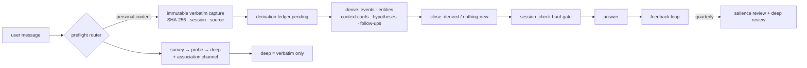

<div align="center">

# Personal Understanding

**A verbatim-traceable agent memory system — it mimics how a human brain associates, fans out, converges, and reasons backward, but every conclusion traces back to the exact words you said.**

Local-first · one folder · Python stdlib only · zero dependencies

[](https://pypi.org/project/personal-understanding/)
[](https://pypi.org/project/personal-understanding/)
[](LICENSE)
[](https://github.com/caix84476-netizen/personal-understanding/stargazers)

[中文](README.md) · [Architecture](#architecture) · [Quick start](#quick-start)

</div>

---

## What it is

A personal memory for your AI assistant. The things you tell it actually become "knowing you as a person" — not just each sentence squashed into a summary and dumped in a vector store.

The big difference from every memory tool out there is the order of operations: **it saves your exact words first, then derives understanding from them.** No summarizing first, no interpreting first. So six months later, when it misremembers you, you can audit it; when it isn't sure, it says so — instead of inventing a plausible-sounding answer.

## How it remembers

A message comes in and goes through roughly this:

1. **Capture verbatim** — the complete message is written word-for-word, with a SHA-256 hash, timestamp, and session tag. Once written, it can't be overwritten. Corrections add new captures; nothing is silently edited.
2. **Derive** — events, people, places, context cards, causal hypotheses are split out of the verbatim, and each one links back to the exact quote it came from. The model's own guesses (e.g. "why am I always like this") live in a separate layer, marked `candidate` by default — never silently promoted into fact.
3. **Close the loop** — saving the words is not a finished update. Every capture must be split, linked, and closed, or explicitly closed as "nothing new." Orphan captures can't slip past the gate.
4. **Recall like a brain** — it doesn't dump the whole archive into the model. Three layers: `survey` reads a compact "where am I, where do I look" routing map; `probe` fans out along people, context cards, time neighbors; `deep` goes back to the exact quote. In between runs an **association channel**: it diffuses across the archive graph and surfaces candidates that share zero surface words but are genuinely related — like suddenly remembering something that seems unrelated but isn't. For broad questions ("what should I do"), it splits into a few lines of probe each and stitches the threads together — detective-board convergence.

## Architecture



On disk it's plain files you can grep and back up: `sources/conversation/` holds the immutable verbatim + hashes, `memory/v2/` holds the derived timeline, entities, context cards, hypotheses, follow-ups, and retrieval traces. Old summaries that lost their source are honestly tagged `summary_only`, and retrieval tells you "this part comes from an old summary, not the verbatim."

## Quick start

```bash
git clone https://github.com/caix84476-netizen/personal-understanding.git \
    ~/.claude/skills/personal-understanding      # or your client's skills folder
python scripts/init_archive.py            # bootstrap the archive skeleton (idempotent)
python scripts/install_mcp.py --auto      # register the local MCP server (idempotent)
# restart your client — personal_* tools go live, just talk normally
python scripts/open_dashboard.py           # open the audit dashboard anytime
```

Requires Python 3.10+, stdlib only, zero pip deps, Windows / macOS / Linux. You can also `pip install personal-understanding` for the server side, but the full skill brain (`SKILL.md` + audit dashboard) is best via the clone above.

Once it's in, just talk — "I've been feeling…", "remember that…", "why do I keep…" — and it picks it up. Ask "what do you remember about…", or "where does that come from?", and follow the evidence chain all the way down.

## Your data stays yours

Everything runs locally, inside the skill folder. No telemetry, no cloud calls, no third-party embeddings. The shipped `.gitignore` blocks `memory/`, `sources/`, and `backups/` — you can version-control your skill folder and never accidentally commit your private archive.

## Where it came from

Not a framework thought up in an afternoon — a working archive refined through daily use and a dozen hardening rounds (see the [CHANGELOG](CHANGELOG.md)). A salience-decay bug that once shredded frontmatter is why all writes are now atomic; survey used to load ~800 KB of legacy catalog per turn — now it's a ~90 KB routing map; the whole derivation-closure and hard-gate machinery exists because "trust me, I saved it" wasn't good enough for real life.

## License

[MIT](LICENSE) © 2026 caix84476-netizen
