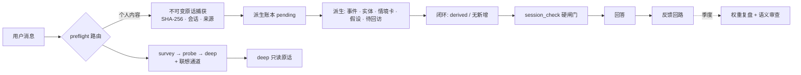

<div align="center">

# Personal Understanding

**一个带原话溯源的 agent 记忆系统——模拟人脑的联想、发散、聚合、逆向，但每条结论都追得回你当时说的原话。**

本地优先 · 一个文件夹 · 仅 Python 标准库 · 零依赖

[](https://pypi.org/project/personal-understanding/)
[](https://pypi.org/project/personal-understanding/)
[](LICENSE)
[](https://github.com/caix84476-netizen/personal-understanding/stargazers)

[English](README.en.md) · [架构](#架构) · [上手](#上手)

</div>

---

## 这是啥

给 AI 助手用的个人记忆。你跟它聊过的事，它会真的"记得你这个人"，而不只是把每句话压成一句摘要扔进向量库。

它跟市面上记忆工具最大的不同，是流程顺序：**先一字不改存下你的原话，再从原话里派生理解。** 不是先摘要、先解读。所以半年后它把你记错了，你能审计；它不确定，它会说不知道——而不是编一个看起来合理的答案糊弄过去。

## 它怎么记

一段话进来，大概经过这么几步：

1. **先存原话**——完整消息一字不改落盘，带 SHA-256 哈希、时间戳、会话标识，存了就不许覆盖。纠正只新增，不静默改。
2. **再派生**——从原话里拆出事件、人物、地点、情境卡、因果假设，每一条都挂回它出自的那句原话。模型自己猜的（比如"我为什么总是这样"的成因）单独放一层，默认标 `candidate`，绝不悄悄转正成事实。
3. **关闭闭环**——存下原话不等于档案更新完了。每条都得拆完、链完、关掉，或者写明"没新东西"再关。孤立捕获过不了闸。
4. **检索时像人脑**——不把全库灌给模型，分三层走：`survey` 先看一张紧凑的"我在哪、该往哪找"路由地图，`probe` 沿人物、情境卡、时间邻居发散开，`deep` 回到原话核验。中间还夹一条**联想通道**：沿档案图扩散，带出词面都对不上、但确实相关的候选——像你突然想起一档子八竿子打不着、可就是有关联的旧事。遇到宽泛问题（"我该怎么办"），就拆成几条线分别 probe，再把线索拼起来——侦探拼图式的聚合。

## 架构



落盘就是普通文件，能 grep、能备份：`sources/conversation/` 存不可变原话 + 哈希，`memory/v2/` 存派生的时间线、实体、情境卡、假设、待回访、检索轨迹。丢了来源的旧摘要诚实标成 `summary_only`，检索时会告诉你"这段来自旧摘要，不是原话"。

## 上手

```bash
git clone https://github.com/caix84476-netizen/personal-understanding.git \
    ~/.claude/skills/personal-understanding      # 或你客户端的 skills 目录
python scripts/init_archive.py            # 初始化档案骨架（幂等）
python scripts/install_mcp.py --auto      # 注册本地 MCP 服务（幂等）
# 重启客户端，personal_* 工具上线，正常聊天即可
python scripts/open_dashboard.py           # 随时打开审计面板
```

需要 Python 3.10+，仅标准库，零 pip 依赖，Windows / macOS / Linux 都行。也能 `pip install personal-understanding` 装服务端，但完整的 skill 大脑（`SKILL.md` + 审计面板）建议用上面的 clone。

装好正常聊就行——"我最近……""记住一下……""为什么我总是……"，它会自己接住。问"你还记得……吗""这结论哪来的"，顺着证据链走到底。

## 你的数据归你

全在本地、在 skill 目录里跑。无遥测、无云调用、无第三方 embeddings。`.gitignore` 默认挡住 `memory/`、`sources/`、`backups/`——你给 skill 目录做版本管理也绝不会误提交私人档案。

## 它从哪来

不是拍脑袋想出来的框架——是一份天天在用的档案，被十几轮加固磨出来的（见 [CHANGELOG](CHANGELOG.md)）。一次撕碎 frontmatter 的权重衰减 bug 让所有写入变成原子操作；survey 曾每轮加载 800KB 旧目录，现在压成一张 ~90KB 路由图；整套闭环和硬闸门，是因为"相信我，存好了"在真实生活里不够格。

## 许可

[MIT](LICENSE) © 2026 caix84476-netizen
